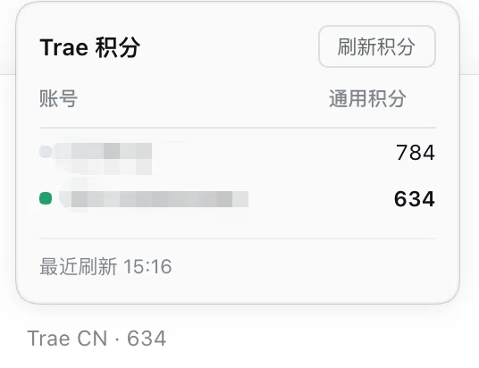

<p align="center">
  
</p>

<h1 align="center">dsh-connect-trae</h1>

<p align="center"><b>Connect locally signed-in Trae models to DeepSeek Harness with local DSH tools, a credits overview, and daily check-in claiming.</b></p>

<p align="center">
  <a href="README.md">中文</a> ·
  <a href="#install">Install</a> ·
  <a href="#how-it-works">How it works</a> ·
  <a href="#model-coverage">Model coverage</a> ·
  <a href="CHANGELOG.md">Changelog</a> ·
  <a href="https://github.com/dingminhua/dsh-connect-trae/issues">Issues</a>
</p>

<p align="center">
  <a href="https://www.npmjs.com/package/dsh-connect-trae"></a>
  <a href="https://www.npmjs.com/package/dsh-connect-trae"></a>
  <a href="https://github.com/dingminhua/dsh-connect-trae/actions/workflows/ci.yml"></a>
  <a href="LICENSE"></a>
  <a href="https://github.com/dingminhua/dsh-connect-trae/stargazers"></a>
  <a href="https://dshfind.com/plugins/dingminhua/dsh-connect-trae"></a>
</p>

A [DeepSeek Harness (DSH)](https://github.com/deepseek-ai/deepseek-harness) bundle plugin that connects locally signed-in Trae models (**CN, enterprise, and international installs**) to the DSH model picker. Trae generates structured tool calls while DSH executes its own local tools, with a usage overview (Work/general credits on CN, tenant allowance on enterprise, subscription status on international), daily check-in claiming, and a model-management panel. **The CN, enterprise, and international sides are three parallel providers (`trae` / `trae-enterprise` / `trae-global`) that can be used at the same time**; the settings card separates them with tabs for convenient management.

**Runs on macOS, Windows, and Linux**: CI runs the full typecheck / test / build matrix on `ubuntu-latest` and `windows-latest`, and Windows gets purpose-built handling for directory probing, app version headers, and lock behavior — see [Windows notes](#windows-notes).

> Apart from the daily check-in claim, every query this plugin makes is read-only and consumes nothing; the claim only happens when you click the button.

> **Boundary: this plugin does not interoperate with any other plugin.** Accounts, credentials, the model directory, the account pool and the settings namespace belong to this plugin alone; a `trae` failure never borrows another plugin's account or credit, and vice versa. Why, and what that rules out, is in [Relationship to other plugins](#relationship-to-other-plugins).

## Features

- **Three parallel providers** — the CN side registers as the `trae` provider (e.g. `DeepSeek-V4-Flash`, `DeepSeek-V4-Pro`), the enterprise side as `trae-enterprise`, and the international side as `trae-global` (the Gemini/GPT/MiniMax roster); **all three rosters appear in the DSH model picker simultaneously**: different sessions can each pick a side without interfering.
- **Enterprise is a separate billing channel, not an alias for CN** — the same CN credential, when it belongs to a `tob_online` tenant, is served by **two** gateways: the consumer pool (billed against personal credits) and the tenant pool (billed against the enterprise allowance). Same model, two payers, so **you** choose who pays; the plugin never guesses. `trae` never touches the enterprise gateway, and `trae-enterprise` **never falls back** — a refusal is reported as a refusal instead of quietly re-running on personal credits. Enterprise is **off by default**: a personal-only account cannot use the tenant pool, so shipping it enabled would mean handing everyone a provider that fails on first use.
- **Any panel can be switched off on its own** — each tab carries its own checkbox (CN and international checked by default, enterprise not): unchecking **withdraws that provider from the DSH model picker entirely** (not merely hiding the tab) and stops all of its requests; checking it again restores it with the account, directory, picks, and context budgets intact. If you never use the international side, just uncheck it.
- **Tabbed settings card** — the card's top carries a "Domestic / Enterprise / Global" tab bar; each tab holds its own account picker, usage overview, and model management. Account, directory, selection, and unsaved drafts are fully isolated per tab — switching accounts or refreshing models on one tab never touches the other side's runtime catalog or sessions. CN and enterprise share one CN credential pool but keep **separate account bindings and model picks**: the two rosters differ (`DeepSeek-V4.1-Flash` is listed only on the enterprise pool), so picks never overwrite each other.
- **The card then splits into "Account / Models / Diagnostics"** (learned from the sibling `dsh-connect-workbuddy`). The region row above is the **scope** — which provider this whole card is about — while these are sections of that one card: Account covers who serves, what is left, the check-in and the pool; Models covers which models to tick, image input, the context budget and Save; Diagnostics read-only lists the panel, the provider id, the serving account, both token deadlines, the catalog/enabled model counts, whether the pool and the check-in are offered, and the **verbatim** text of this panel's last reported failure. **As of 4.4.7 the diagnostics section carries one more line, "quarantined copies"**: a credential copy that could not be read — and was therefore renamed aside instead of being erased — is named there, together with how many accounts it still holds. "Where did the account I remember go?" is now answered by the card instead of by browsing `~/.dsh` for a file name; the signed-out screen shows the same notice, because that is the screen a user lands on after an account disappears. The split exists because the two halves **commit differently**: an account change lands on the click, a catalog change is a draft until Save — so a single long column put the save button three screens away from what it saves. Switching sections never refetches, never drops a half-filled model draft, and never rebuilds the pool's log. A signed-out card renders no section strip, so its one screen of instructions cannot be hidden behind a tab the user cannot see. **The Models section lays every model out at once, with no inner scrollbar** — it is not a little window scrolling inside a page that already scrolls; the card's own page is the only scroll.
- **Multiplier in the model name** — model names show the credit multiplier in Trae's own menu format (e.g. `GLM-5.2 · x0.79`), updated with each directory refresh.
- **Promotion badge** — Trae publishes its discount rules in the model directory (`activity_discount`: pay ratio, list price, off-peak windows with their time zone). The plugin judges them against **the clock at render time** and paints one capsule beside the model name (`5 折` / `off-peak 5 折` / `limited 5 折`), with the old price, the new price and the window on hover. Judging at render time is what keeps a night-time discount from still hanging there the next morning; when upstream says nothing is discounted right now no badge is painted, the multiplier is never used to guess a promotion, and no campaign without an end time is labelled "limited". It is information only: no request and no billing changes, and the international region (subscription) has no such data and therefore shows no badge. See [docs/PROMO_BADGE.md](docs/PROMO_BADGE.md).
- **DSH local tool loop** — gets pending structured `tool_calls` from Trae `llm_utils_chat`, lets DSH execute its own local tools, then returns tool results to the model.
- **Text-to-image (`trae_draw_image`)** — brings the signed-in account's Trae text-to-image service into the conversation: the model draws one image and the plugin **fetches the bytes too**, writes them under the session cwd and shows the picture inline. **Off by default, enabled per panel** — generation really spends credits (measured: ~8.8 for one `1920x1920` on CN personal), so unlike the image-input declaration it only happens when you say so. Protocol, size bounds, the two-step fetch and why the old "fetch" GET is really a second generation are in "Text-to-image" below.
- **Dual-region detection (CN / international)** — detects local sign-ins across Trae CN, TRAE SOLO CN, Trae, and TRAE SOLO installs. The region is derived from the credential's own `userRegion` claim (host suffix and edition label as fallbacks), with no manual switch.
- **Region-isolated directories and selections** — CN and international each keep their own model directory, enabled picks, image opt-ins, and context budgets, and each provider reads only its own slot.
- **Vision follows Trae's own declaration** — when Trae marks a model `multimodal`, the plugin advertises it as such with no manual tick per model (issue #16). The rule is "**models you tick ∪ models Trae marks multimodal**": models Trae marks `false`, or does not mark at all, stay text-only and can still be turned on by hand. A row enabled automatically is shown ticked and read-only, with the reason. See "Image input" below.
- **Account switching** — refreshes the token list and lets users select an account without storing tokens in DSH settings. **Your choice is remembered and stays in effect**: the plugin will never switch accounts on its own just because the bound one ran out of credit or another usable one was found (switching bills a different person). So when the bound account is exhausted the card **says so explicitly** and lists the other accounts on this machine that still have credit, with their balances, for you to switch to in one click — instead of showing an empty panel or quietly rebinding you. "Refresh accounts & tokens" now always reports what happened (how many accounts were found, who is still bound) instead of appearing to do nothing. The dropdown names the product (`Trae` / `TRAE SOLO` / international) so a credential left behind by an uninstalled app is recognisable.
- **Read-only usage and model management** — Work/general credits on CN accounts, subscription/trial status on international ones; enable Trae models freely. Read-only queries consume nothing.
- **Credit-near-expiry notices** — the remaining balance only says "how much is left", not "**which pack lapses first**". The notice escalates by urgency (7 days → 24 hours → already lapsed) and names the amount, the pack count and the soonest expiry, so a user watching only the total never silently loses the pack that expires first. Shown in both the usage card and the composer credits panel on the CN side (the international side is subscription-based and has no per-pack expiry).
- **One-click test of the enabled models** — sends each **enabled** model one minimal message (a single `ping`, no tools) and reports whether it actually answers: **works** / **needs a higher plan** (Trae `1005`; your plan does not cover it) / **not served** (`4001`; no SOLO function serves it) / **throttled** (`4011`; Trae rate-limited that route) / **sign-in rejected** / **not determined**. The last one is a first-class outcome: a timeout, a dropped connection, a proxy or a 5xx is **never** reported as unusable — only an explicit upstream refusal is a negative verdict. This is the plugin's **only** operation that spends quota (check-in changes account state but spends nothing), it runs only when you click, and its results live in the current session rather than in your settings.
  > `4011` is a **rate limit**, not "this model is unavailable" (measured for issue #33): an exhausted balance reports a different code, `4008`, so "I still have plenty of credits" and "I got a 4011" are both true at once. A throttled model answers again after a short wait — do not delete it.
- **One-click test of all models** — the same probe applied to **every visible model** of the current region, not just the enabled ones. Use it when you want to know whether the models you have switched off could still answer — after a plan change, or after Trae reshuffles its lineup.
- **Daily check-in claiming (per account)** — on the CN card **every account row carries its own check-in button**, with the day's reward written on it (`Check in +150`). A row reads **Claimed** and disables itself once *that account* has been paid, and reads **Device used** and disables itself when *this machine* has already spent today's slot through some other account — the two are reported honestly, and the second is never dressed up as "claimed". This is the plugin's **only** operation that changes account state, and it runs only when you click; one click targets that one row's account and sends exactly one request. There is deliberately **no "claim for every account"**: Trae allows **one check-in per device per day** (switching accounts does not reset the slot), so a sweep could only manufacture a row of false failures. The international side has no check-in activity, so no button is shown there.
- **Composer readout** — the composer tool row (between "Expert" and the model selector) shows a clickable readout, refreshing every 5 minutes. **Both regions show it, but they do not show the same quantity, and that is the data's doing**: the CN side is credit-based, so it reads "Trae CN · <general credits>"; the international side is subscription-based and its usage document carries no credit field at all, so it reads "Trae Global · <plan>" (e.g. `Pro` / `Free`). The whole readout is clickable and opens a panel showing a TABLE: one row per account in the region — general credits on CN, plan on international — where clicking a row SWITCHES accounts (through the same merged `accounts` write the card uses, so the other region's selection survives), with the manual refresh button in the panel. It appears **only while the session's selected model belongs to this plugin**, and renders nothing for any other provider — which is what keeps two connector plugins from competing for one shared row (the sidebar foot is a shared root row; the composer row is per-session and provider-scoped).

  

  **Where that readout sits is a choice** (learned from the sibling `dsh-connect-workbuddy` issue #62). The default is the **composer toolbar** (the position described above); if another plugin occupies it and the readout does not appear, move it **below the input box** — the row carrying the round / step / token statistics, where the readout is APPENDED after the shipped figures rather than replacing them. The seat is set **per panel** (all three are stored separately), in the card's settings block next to the "show credits in the composer row" checkbox. Why a second seat exists at all: the composer toolbar is a **shared list slot** that the shell's own controls and every other plugin register into, and a shared slot **cannot promise that every occupant is visible** — the report behind that issue is a readout that vanished entirely once a third-party plugin was installed (this plugin has been squeezed out of a shared row once before too, down to a clipped "Tr" at the sidebar foot).

- **Secure loopback shim** — one random port + in-process random secret per region; the real Trae token is never handed to pi-ai.

## How it works

```text
DSH PiAiAdapter (one stack per provider)
  -> secure loopback shim (one random port + in-process random secret per region)
  -> TraeSoloBridge
  -> CN: https://trae-api-cn.mchost.guru/api/agent/v3/llm_utils_chat
  -> Enterprise: https://console.enterprise.trae.cn/api/agent/v3/llm_utils_chat
  -> Global: https://coresg-normal.trae.ai/api/agent/v3/llm_utils_chat
  -> Trae SSE / pending function_call
  -> OpenAI SSE tool_calls
  -> DSH executes local tools and returns their results
```

Each panel owns a complete runtime stack — credential store, model catalog, wire map, upstream clients, loopback shim, adapter — with visibility filtered by the credential's own region claim, so **accounts from several regions can be signed in and used by different sessions at the same time**.

**A panel is not a region.** `cn` and `ai` happen to line up with the two regions, but the enterprise pool shares the `cn` credentials while billing a different account and serving a different roster — it needs its own switch, its own account binding, and its own model picks. That is exactly what a "panel" is. Keeping panel and region as two concepts lets `enterprise` ride the same settings pipeline with no change to the stored shape: it is just another slot in the `regions` map.

The CN region therefore publishes two providers side by side, and **the route is fixed when the provider's client is built** — there is no "guess once per call". The shim exposes one bearer route per provider and dispatches by bearer; an unknown token gets a 401 rather than falling back to the first route. The enterprise gateway requires a `session_id` on every call while the consumer gateway rejects a body carrying one, so it is added only on that route.

Usage overview hits the read-only `https://api.trae.cn/trae/api/v2/pay/*` and `/trae/api/v2/ug/*` endpoints (international accounts read their own gateway's subscription status); the daily check-in claim is the one write among them, going to `POST /trae/api/v2/ug/checkin_credits/claim` with this installation's device id (`x-device-id`, the same identity the chat path sends). That device id is also what Trae keys the "one check-in per device per day" rule on, so switching accounts does not reset the day's slot. Refreshed tokens are kept per region in `$DSH_HOME/.trae-auth.cn.json` and `$DSH_HOME/.trae-auth.ai.json` (two simultaneously signed-in accounts never overwrite each other; the legacy single file `.trae-auth.json` is still read as a migration source).

> See `docs/IMPLEMENTATION_PLAN.md`, `docs/SOLO_ROUTE_DECISION.md`, `docs/USAGE_API_RESEARCH.md`.

## Relationship to other plugins

**This plugin does not interoperate with any other plugin.** That is a boundary, not a slogan:

- **No shared state.** Accounts, credentials, the model directory, the account pool, access tokens and the device id belong to this plugin alone; it reads and writes only its own files (`$DSH_HOME/.trae-auth.*.json`, `.trae-auth.deleted.*.json`, `.trae-pool.*.json`) and its own settings namespace — it does **not** read, write, or supply data to any other plugin. It does edit the Trae desktop app's own sign-in file, but that is another **application**, not another plugin.
- **No cross-plugin account or credit scheduling.** The pool ranks and switches only among this plugin's own accounts; a `trae` failure is a failure — it never borrows another connector plugin's account, credit or channel, and never hands a request to another plugin to retry. The reverse holds too: no plugin can send requests through this one.
- **No slot negotiation.** Whether the card and the composer readout appear is decided by **whether this plugin's provider is selected** (read from DSH's own `modelSelection` projection), not by plugin-to-plugin messages allocating space. Two connector plugins installed together coexist because each appears only for its own provider — that is **non-interference**, not collaboration.
- **No shared switches.** Turning one panel off withdraws only this plugin's provider and requests; it never changes another plugin's provider, models, binding or settings.

**Why the boundary exists.** Once plugins depend on each other, any upgrade, uninstall or version-line change silently alters the behaviour of its neighbours — and DSH's load order, parallel versions and user-authored profiles make that coupling impossible to express reliably. Holding the boundary keeps "who is broken" answerable with **one** plugin instead of a chain.

> Sibling plugins **learn from** each other (lessons from `dsh-connect-workbuddy` are quoted in this repository's comments and tests) but never **call** each other — learning is a compile-time affair, interoperation is a runtime one, and the two must stay apart.

## Image input

The plugin declares whether a model accepts images, and DSH uses that to decide whether an attachment is **sent as-is** or **degraded into a text description**. That makes the declaration a hard switch, not a cosmetic label.

The rule is the **union of two sources** (issue #16):

| Source | Meaning |
|---|---|
| Trae's own `multimodal` field | Trae's own answer to "does this model read images". The Trae IDE's attach-image button is driven purely by this field, with no user switch |
| Your manual `imageModelIds` ticks | Explicit choice. Even if Trae later stops reporting the flag for that model, your tick is never revoked |

Notes:

- **Only `multimodal === true` enables it automatically.** A missing field (a directory saved by an older release, a fallback row) or an explicit `false` stays text-only — better to not send than to advertise a capability we cannot confirm.
- **Automatic does not mean automatic sending.** It only lets DSH attach an image to that model; you still choose to attach one per message. The plugin never sends an image on your behalf.
- **An automatically enabled row is shown ticked and read-only.** Under the union, unticking it would be re-applied immediately, so offering a clickable box would be a lie. There is currently no per-model "force off" escape hatch; if you want one, say so on issue #16.
- Manual ticks still work for models Trae marks `false` (or does not mark), which is the escape hatch for "upstream does not say so, but it actually works".

## Text-to-image (`trae_draw_image`)

The text-to-image service behind TraeWork / SOLO is now reachable from a DSH conversation: the model **draws one image** and the result is written to a local file.

**Off by default, switched on per panel.** Generation **really spends credits** (measured: ~8.8 for one `1920x1920` on CN personal), so this is not the image-input kind of declaration — it is an explicit spend gate. Tick "Allow the model to generate images" (`drawImageEnabled`) in the card's model column and that panel's `trae_draw_image` gets registered with DSH; unticking removes it immediately. Each panel stores its own switch; the enterprise and international panels do not offer one — the former's tenant gateway is a separate billing surface, the latter bills under another plan, and neither has been measured, so the plugin does not pretend otherwise.

**The protocol (all measured, none of it guessed from the binary):**

| Item | Fact |
|---|---|
| Endpoint | `POST /api/ide/v1/tool_text_to_image` (plus an SSE variant `..._stream`), model `seedream_5` |
| Request body | Only `{prompt, image_size?}`. Adding known fields (`mode_type` / `session_id` / `image_urls` / `watermark`) earns a 400 with an empty body; unknown fields are ignored |
| Success | Flat `{"message":"success","uri":"tos-cn-i-…/cn/<uid>/gen_image/<ts>_<hex>_jpeg_1920x1920"}` — **no** `{code,msg,data}` envelope |
| Sizes | Total pixels must land in **3686400 ~ 16777216**: `1024x1024` is rejected as too small (`code 3003`, no charge) and `4608x4608` as too large; presets `2k`/`3k`/`4k` work, default is `1920x1920` |
| Fetch | **Two steps, no extra charge**: `POST /api/ide/v1/get_resource_url` whose body must be exactly `{"uri_list":["<key>"]}` (`{uri}`/`{path}`/`{resource_uri}`/`{uris:[…]}` and GET `?uri=` all answer 200 with an empty `url_map`), replying `{"url_map":{"<key>":"<byteimg signed URL>"}}`; then a plain GET of that signed URL (**no Trae headers** — the signature is in the query) returns the bytes: measured `image/jpeg`, 1,155,578 bytes, header `ffd8ffe0` |
| What that GET really is | Decisive probe: after the POST returned `…/1792954795741_44f94116_jpeg_1920x1920`, the GET with the same `(prompt, size)` came back with a **different** uri (`…/1792954810505_b107ac11_jpeg_1920x1920`) after 27 s and zero pixels — a second image and a second charge (~17.6 for the pair). The illegal-size probe agreed: the error is Ark's own `[callArkImageGeneration]` |

**The bytes really do come back.** On success the tool returns `url` (the Trae object key, kept for diagnostics), `path` (a local file relative to the session cwd, e.g. `trae-images/trae-20261026-0420-ab12cd.jpg`), `model`, `prompt`, `size` and a `hint`; the renderer emits `` — DSH's chat resolves that relative path against the session cwd and reads the bytes through the host's authenticated `api/file` route, so the picture shows up inline. Only when the bytes genuinely could not be fetched (`IMAGE_UNAVAILABLE`: the image was generated and charged) does it fall back to inline-code "key only", and such a failure still starts the 30-second cooldown — generation is billed per image, so a retry buys another one.

**Image editing and text-to-video are not opened up.** Editing needs a TOS upload presign first (this plugin has no such path); video polls a material result — a separate async pipeline. Neither ships, and neither leaves half an entry point behind.

## Model coverage

This plugin serves models from Trae's **SOLO channel** (`DeepSeek-V4-Flash-Official`, `DeepSeek-V4-Pro-Official`, `GLM-5.3`, `GLM-5.2`, `Kimi-K3`, `MiniMax-M3`, `Qwen3.8-Max`, `Doubao-Seed-*`, …), for both the domestic and international sides.

The following two models currently come from the **TraeCode (Trae IDE) channel** and have **not** been opened up to the SOLO channel:

| Model |
| --- |
| `kimi-k2.8-preview` |
| `qwen3.8-flash` |

They **do appear in the model list** (Trae's directory advertises them), but the plugin has no channel that can call them yet. Sending a message with one selected produces an **explicit error**, for example:

```
Trae does not serve this model under the SOLO function the request used
(config_name rejected) · Trae code 4001 · upstream: We're sorry, the param is invalid…
```

That is the upstream refusal stated plainly, rather than a silent failure or something that reads like a network fault. **Once Trae opens them up to the SOLO channel the plugin picks them up automatically** (the test is simply whether a callable id can be resolved) — no plugin upgrade needed.

> **Why they are listed now (policy from 2026-10-02)**: such rows — present in the directory but with no resolvable callable id — used to be **hidden outright**, on the grounds that showing one only produces an error. But the callable rosters are issued **per account tier**: not seeing a model on a free account does not prove a paying account cannot call it (the reporter in issue #19 is on Pro, and their account calls models this machine's free account gets gated on). **Hiding models the user's own Trae IDE lists is worse than showing an explicit error**, so the behaviour is now: list everything, report refusals honestly.

> `deepseek-v4.1-flash` used to be listed here — `docs/DS41_CALLABILITY.md` (evidence gathered 2026-09-15) measured `4001 param is invalid` from all eight SOLO functions. **Trae has since opened it up to the SOLO channel**: it now ships in the live directory with `wireFunction: solo_work_remote` and calls succeed (verified against a live refresh). This page had not caught up, so it is removed from the table.

> `glm-5.3-flash` used to be listed here too, and is **removed as of 4.4.0**: Trae has since opened it up, and it now ships in the live wire roster with `wireFunction: solo_work_remote` (verified). The directory side always advertised it — it was listed because the Remote directory named it while the wire roster did not, so it had no callable id and never entered the callable roster. 4.4.0 fixed both "the wire has it but the directory does not" and "the directory was asked for too few groups", and it now appears as an ordinary callable model.

> Note the distinction: **`GLM-5.3` is supported** (it goes through the SOLO channel). **`glm-5.3-flash` is now supported too** — it was always a different model from `GLM-5.3`, but it has since been opened to the SOLO channel.

To use these two models today, use the **Trae IDE itself**.

## Max output and context budgets

The "最大输出" (max output) on the model card comes from `model_detail_list[].max_tokens` in Trae's `get_detail_param` — upstream **does** publish it (live-verified: 80/80 CN configs carry it). As of 4.0.1 the value travels through the catalog merge all the way to the card, `/models/refresh` and DSH model registration; before that the merge step dropped the field, so the whole region rendered blank (issue #42 — full diagnosis in `docs/ISSUE42_DIAGNOSIS.md`). **Rows that are still blank are being honest**: models the directory lists but the SOLO roster has no config for (the three TraeCode rows above) have no candidate value to show — we prefer a blank over an invented cap. The value is metadata only; the plugin never puts `max_tokens` into request bodies (the server decides the real cap).

Context windows are a per-model choice between Trae's default (dev) window and its Max window — **and, as of 4.4.8, a 500K middle step for wide-window models** — stored per panel as `contextBudgets`. 500K is **not** an upstream-advertised window; it is a local half-way point. Dev windows are typically 200K/256K/272K and Max is typically 1M, so going straight from default to Max is a 5× jump, and Max-tier billing is not what every session needs. It is therefore **conditional**: the option only appears when that model's Max is at least 500K, and 500K is genuinely wider than its dev window and narrower than its Max. `applyContextBudgets` validates against the **same rule** (`contextBudgetOptions`), so a stored value that is not one of that model's selectable windows always falls back to the dev window — it can never push a model past a window it does not have (if upstream later shrinks a model's Max to 256K, a stale 500K quietly stops applying instead of overflowing).

For a whole-region switch, the model section has three buttons: "**Switch all to 500K**" (writes 500K for every row whose Max is at least 500K, leaves the rest alone), "**Switch all to Max**" (writes each Max-capable row's `maxContextWindow`, leaves no-Max rows and existing manual budgets alone) and "**Restore default context**" (clears the region's budget dict). All act on the draft and take effect on Save, producing exactly the same stored shape as the per-row radios (issue #42 side request — 18 Max rows in CN used to mean 18 clicks).

## Install

```sh
dsh plugin --profile desktop add dsh-connect-trae
```

Or directly via npm:

```sh
npm install dsh-connect-trae
```

Restart the DSH process after install/update/uninstall.

## DSH version compatibility

**Requires DSH 0.1.7-rc.1 and up** (since 2.3.0 the plugin no longer targets hosts older than 0.1.7; the peer dependency ranges are narrowed accordingly).
**The peer upper bound is `<0.3.0-0`, so both the 0.1.7 and the 0.2 line are supported (including 0.2.1-rc.3, verified).**

### Both pi-ai context generations are supported (since 3.4.2)

DSH itself spans two generations of `@earendil-works/pi-ai`, and **which one this plugin resolves to is decided by your install**, not by the host — declaring it a peer is correct, but the two generations disagree on what a context looks like:

| | legacy (≤0.85) | modern (0.86+) |
| --- | --- | --- |
| shape | `{ systemPrompt, tools, messages }` | `{ messages: [ {role:'system', content, toolsAdded}, … ] }` |
| system prompt | top-level `systemPrompt` | **only** on that system message |
| tool declarations | top-level `tools` | **only** on that system message's `toolsAdded` |

A mismatch breaks **in both directions**, so since 3.4.2 the plugin adapts bidirectionally according to the generation it resolved (issue #27):

- **Modern host + legacy library**: a guaranteed crash — the legacy token estimator has no `role === 'system'` branch, so it iterates a string and throws `Cannot read properties of undefined (reading 'length')`. This happens before the request is built, which is why it looks like "every model crashes, within milliseconds, with all-zero usage".
- **Legacy host + modern library**: no crash, but the modern api reads only that system message and silently ignores the top-level fields — the system prompt and **every tool declaration** are lost, so the model can never emit a tool call. Quieter, and also fixed.

The generation gate is the copy **this plugin resolved** (its manifest version; package layout when that is unreadable), **not the host version** — a nested older copy shadows a newer host copy and vice versa. Startup logs one line, `dsh-connect-trae: pi-ai <version> (<generation>)`; `legacy` means your install resolved to the ≤0.85 line.

The boundary is **0.86**: `dist/utils/transcript.js`, `normalizeContext`, the estimator's system branch, and the switch away from the top-level fields all land in 0.86.0 together. Gating on `0.87` misclassifies 0.86.x as legacy and folds a context the modern api consumes natively, destroying the prompt and the tools.

The 0.2.0 line breaks **no** contract this plugin consumes — a symbol-by-symbol check confirmed every API it imports is unchanged ([full 0.2.0-rc.1 impact check](https://github.com/dingminhua/dsh-connect-trae/blob/main/docs/DSH_0.2.0_RC1_IMPACT_CHECK.md)). But since 0.1.7 DSH enforces a **bundle-level peer gate**: a bundle whose peers are unsatisfied is skipped **whole**, with one line on stderr and nothing in the UI — the plugin simply disappears.

### DSH 0.2.1 line (pi-ai 1.1.0) sync

The `0.2.1-rc.1` host moved `@earendil-works/pi-ai` from `^0.85.1` to **`^1.1.0`** (unchanged through `0.2.1-rc.2` and `0.2.1-rc.3`) — the only change on the 0.2 line with real behavioural impact. Three conclusions:

1. **The request body did not regress (measured, not inferred).** The 1.1.0 api reads the prompt **only** from a transcript system message and never touches top-level `systemPrompt` / `tools`, while `dsh-llm-pi-ai`'s `piContext()` still emits the legacy envelope. The bidirectional adapter this plugin has shipped since 3.4.2 covers exactly that: feeding the real host envelope through real `1.1.0` with a local SSE capture yields `roles: ["system","user"]`, an intact system text and `tools: 1`; **without the adapter it degenerates to `roles: ["user"]`, system `null`, `tools: 0`** — with no error. That contrast is pinned as a wire-level matrix in `tests/pi-ai-context.spec.ts`.
2. **Types were fixed.** 1.1.0 changed `ProviderStreams`' second parameter to a **branded** `TranscriptContext` (a `unique symbol` only `normalizeContext()` can produce). The adapter casts once at that single boundary (`withContextAdaptation` in `src/adapter.ts`) and documents why the brand cannot be obtained honestly there.
3. **The peer range needed no change.** DSH evaluates with `semver.satisfies(runtime, range, { includePrerelease: true })` and checks only the `@deepseek-ai/dsh*` namespace, so `>=0.1.7-rc.1 <0.3.0-0` already admits `0.2.1-rc.1`, `0.2.1-rc.2` and `0.2.1-rc.3` (verified). Note the prerelease cliff only exists under **default** options — it is not this plugin's situation.

The dev tree pins `@earendil-works/pi-ai` at exactly **1.1.0** (the version the host actually bundles — still 1.1.0 on `0.2.1-rc.3`) rather than `^1.1.0`, so local typecheck and tests run against the same contract users do; the `schemastery` override moved to `3.18.5` (`dsh-llm-pi-ai@0.2.1-rc.3` declares `~3.18.5`).

### `0.2.1-rc.3` sync (since 4.4.6)

The host moved to `0.2.1-rc.3` (the desktop app's `CFBundleVersion` and the bundled `dsh-desktop-runtime` both report `0.2.1-rc.3`). Upstream shipped five commits: three of them are the new "navigation entry customization" UI (pin/unpin plugin launchers, a More menu, analytics), one switches the DeepSeek API-key route to the official `/models` listing, one is the version bump.

For **this plugin**:

- Of the 13 host packages the plugin consumes, **only `dsh-client-ui-primitives` changed code**, and every change is **additive**: `Tooltip`'s `TooltipSide` gains `'left'` and now places the bubble from measured border boxes (preferred → opposite → perpendicular side), `MenuItemButton` gains `current`, `Menu` gains `minWidthFromAnchor`, and the icon set gains `IconAppsAddOutline*`. This plugin references `dsh-client-ui-primitives` **at the type level only** (`import type {} from ...`) and never touches those components at runtime, so **no adaptation is needed**.
- The other 12 packages (`dsh-llm`, `dsh-llm-pi-ai`, `dsh-settings`, `dsh-host-webserver`, `dsh-atomic-write`, `dsh-home-paths`, `dsh-attachment`, `dsh-client-ui-renderer`, `dsh-client-ui-settings`, `dsh-client-ui-settings-plugins`, `dsh-client-ui-slots`, `dsh-client-locale`) are **byte-for-byte unchanged**.
- Every slot this plugin registers (`plugins.bundle.config`, `plugins.row.config`, `conversation.input.left`, `conversation.composer.dock`, `conversation.input.model.label`) **still exists with an unchanged contract** on rc.3; the host's new slots (e.g. `conversation.session.header.views.actions`) do not overlap with them.
- The peer range **needs no change**: `0.2.1-rc.3` is admitted by `>=0.1.7-rc.1 <0.3.0-0` (verified).

Details: [section 10 of `docs/DSH_0.2.1_RC1_SYNC.md`](https://github.com/dingminhua/dsh-connect-trae/blob/main/docs/DSH_0.2.1_RC1_SYNC.md).


### Why the upper bound is not `<0.2.0`

2.3.1 wrote `<0.2.0-0`, meaning "not the 0.2.0 release yet". That spelling is **wrong**: in SemVer `0.2.0-rc.1 < 0.2.0-0`, so it excluded the entire 0.2.0 **prerelease** line, and the plugin went dead the moment a user installed the first 0.2.0 prerelease.

| Spelling | 0.1.7 line | 0.2.0 alpha/rc | 0.2.0 release | 0.3.0 |
| --- | --- | --- | --- | --- |
| `>=0.1.7-rc.1 <0.2.0-0` ❌ | ✅ | ❌ | ❌ | ❌ |
| `>=0.1.7-rc.1 <0.2.0` | ✅ | ✅ | ❌ | ❌ |
| `>=0.1.7-rc.1 <0.3.0-0` ✅ | ✅ | ✅ | ✅ | ❌ |

`tests/dsh-peer-range.spec.ts` pins this invariant: every peer range must admit the 0.1.7 and 0.2 lines, must reject the 0.3 line, and `<0.2.0-0` may not come back.

> **Why this needs a dedicated test**: a wrong range passes `tsc`, every unit test, `pnpm install`, and CI — only a real host refuses to load it. That is exactly how 2.3.1 shipped green.

0.1.7 rebuilt the settings machinery, and the plugin follows the 0.1.7 contract:

- **Host registration**: `SettingsForms.configure({auto}, owner)` (`installSection` was removed in 0.1.7), and the namespace is the **Loader entry id the host actually serves** (`ctx.fiber.entry?.options.id`, falling back to `trae`) — the harness looks a provider's namespace up by exact match, so hard-coding `trae` made the provider read as "not configured".
- **Client settings surface**: `configForms` (`settingsScope` was removed in 0.1.7). `inject` declares only `slots` / `locale`; the settings surface is probed with `ctx.get()`. Cordis' dependency gate is hard — any `inject` entry the running line does not provide keeps `apply()` from ever running (this is why 2.2.0 and earlier sat at `pending (waiting for service: settingsScope)` on 0.1.7).
- **Config card slots**: `plugins.bundle.config` / `plugins.row.config` (`settings.plugin.item` was removed).
- **Schema writable marker**: writable fields must be marked `volatile()` (`asVolatile`), or 0.1.7's write gate rejects every write; 0.1.7 delivers config values as `{get(): T}` live references, so every read and merge path unwraps them first (`unwrapVolatile` / `unwrapVolatileDeep`).
- **The collapse caret is pure CSS**, with no static primitives icon import — icon naming changes across releases, so a static import is not a stable contract.

## Platform support

| Platform | Status | Notes |
| --- | --- | --- |
| **macOS** | ✅ Fully supported | Development and verification environment; directory names confirmed on a real host |
| **Windows** | ✅ Supported | CI runs `windows-latest`; account directory, app version headers, and lock behavior all handled. **Verified on a real host** (Windows 10.0.22621 + TRAE SOLO CN) — see below |
| **Linux** | ✅ Supported | Includes the WSL2 + Trae CLI case (issue #5); directory names probed as multiple candidates |

All three platforms share one implementation: account discovery, decryption, region routing, check-in, and usage queries are platform-independent. Platform differences are confined to **path resolution** (`src/paths.ts`) and the **device fingerprint** (`src/identity.ts`).

## Windows notes

- **Account data directory**: the plugin reads `%APPDATA%\<directory name>\User\globalStorage\storage.json` (unrelated to the **install** directory — this Electron family keeps user data under `%APPDATA%` even when installed on another drive). It probes several directory spellings **in parallel** (`Trae CN` and `trae-cn`, `TRAE SOLO CN` and `trae-solo-cn`), and any hit works. Windows file systems are case-insensitive, so the same directory is never probed twice.
- **App version headers**: read from `<LOCALAPPDATA>\Programs\<install directory name>\resources\app\product.json` (falling back to `<home>\AppData\Local` when `LOCALAPPDATA` is unset) and sent as `x-app-version` / `x-ide-version`; if unreadable those headers are omitted and nothing else is affected.
- **Device fingerprint**: `x-device-type` is sent as `windows` and `x-os-version` as `Windows <release>`. The machine id comes from the data directory's `telemetry.machineId` (or a sibling `machineid` file), which holds on Windows.
- **File locking**: the host's `dsh-atomic-write` handles Windows exclusive-create semantics (`EPERM` / `EBUSY` retries) natively; no plugin-side adaptation is needed.
- **Raw Chat probing (known limitation)**: `model-cache` depends on the `sqlite3` command-line tool, which is not installed by default on Windows; that probe fails and **falls back safely**. Raw Chat is off by default and does not affect the main flow.
- **Permission bits**: credential copies are written with `mode: 0o600` / `dirMode: 0o700`, which Windows ignores — no error, documented as harmless.

### Real-host verification result (2026-09-26, Windows 10.0.22621 + TRAE SOLO CN)

`node scripts/verify-windows.mjs` passed **everything** (exit code 0):

| Check | Observed |
| --- | --- |
| Directory probe | Hit `%APPDATA%\TRAE SOLO CN\User\globalStorage\storage.json` (all other candidates missing) |
| Account resolution | 1 account resolved, `solo` / `cn` region |
| `x-device-type` | `windows` ✅ |
| `x-os-version` | `Windows 10.0.22621` ✅ |
| `x-device-id` | 16 digits, all numeric (read from the data directory, not the fallback hash) ✅ |
| `x-app-version` | `0.1.56`, read from `%LOCALAPPDATA%\Programs\TRAE SOLO CN\resources\app\product.json` ✅ |

**What this confirms**: using `win32DirName` as the authority is **correct** — the `TRAE SOLO CN` spelling really is the directory name on a real Windows host, and both the `product.json` install-path derivation and every device-fingerprint field hold. In other words "the plugin can read Trae's sign-in on Windows" is now backed by real evidence rather than inference.

#### Runtime paths beyond the script (same host, 2026-09-26)

The six checks above cover **path probing and the device fingerprint only** — that is not the same as "the whole plugin works on Windows". So the plugin's main flows were exercised separately, calling the `lib/` exports directly (i.e. the product code itself):

| Runtime path | Observed |
| --- | --- |
| `TraeCredentialStore.resolve()` | ✅ returned a credential, host `https://api.trae.cn`, token expiry parsed |
| `identityHeaders()` (all headers) | ✅ all 10 headers produced (`x-device-id` / `x-machine-id` / `x-device-cpu` / `x-ide-version-code`, …) |
| Usage query (read-only, consumes no credits) | ✅ 9 credit packs, total 2050 / consumed 1522.85 |
| Model directory fetch (read-only) | ✅ **42 models** returned |
| `writeFileAtomic` | ✅ write + read-back identical |
| Concurrent `withFileLock` | ✅ 8 concurrent writers serialized correctly with **no lost updates** (Windows exclusive-create semantics are handled by the host — now verified rather than assumed) |
| `SSE` decoding | ✅ splits on `\r?\n`, so CRLF and chunk splits are both handled |

In short: sign-in, identity, usage, model directory, and concurrent writes are all **verified working on Windows**.

> **Known limitation (its behaviour confirmed on this host)**: `model-cache` depends on the `sqlite3` command-line tool, which is not installed here; it threw `ENOENT` (`spawn sqlite3 ENOENT`) and the caller's `.catch(() => undefined)` fell back correctly — **the main flow is unaffected**, and Raw Chat is off by default.
>
> **That module's directory-spelling gap has been fixed** (found and fixed in the same round): it used to **hardcode the single spelling `Trae CN`** for the `state.vscdb` path while `paths.ts` probes multiple candidates, and it re-derived the directory instead of reusing `traeStorageCandidates`. On this host — whose real directory name is `TRAE SOLO CN` — the old code pointed at `...\Trae CN\...\state.vscdb`, which **does not exist at all**; only because `sqlite3` is absent did that call necessarily fail and fall back, hiding a **wrong path** behind a different, plausible-looking error (a missing dependency).
>
> The fix derives the cache path **from the credential path**: `state.vscdb` and `storage.json` share one `globalStorage` directory, so the candidate that yields the sign-in also owns the cache. `raw-resolver` now passes the resolved candidate down, so a machine with several editions installed cannot read another installation's model map. Re-measured on the real host: the new code selects `%APPDATA%\TRAE SOLO CN\User\globalStorage\state.vscdb` (which exists), where the old code only ever looked at `Trae CN` (which does not).

> **What remains unverified**: this host only had TRAE SOLO CN installed, so the `Trae CN` / `trae-cn` spellings are **still unconfirmed on a real host** — their absence here only means this build is not installed, not that the spelling is wrong. Windows users running Trae China Edition are still welcome to run the command above and report.

> **Running Trae China Edition, or a different setup? One command reports it**: `node scripts/verify-windows.mjs` — it uses the plugin's own build output to list every path it probes on this machine, whether an account can be resolved, and the device fingerprint. Its output is **already redacted** (user name becomes `<user>`; account and device ids are reported as shape only) and can be pasted into an issue as-is. **Full steps and how to read the result are in [`docs/WINDOWS_VERIFY_GUIDE.md`](https://github.com/dingminhua/dsh-connect-trae/blob/main/docs/WINDOWS_VERIFY_GUIDE.md)**; step-by-step manual troubleshooting is in [`docs/WINDOWS_TOKEN_PROBE.md`](https://github.com/dingminhua/dsh-connect-trae/blob/main/docs/WINDOWS_TOKEN_PROBE.md) (**it only asks for directory and key names, never for tokens**). If the directory name still does not match, `authFile` + `edition` can point at the exact path as a workaround.

## Development

```sh
pnpm install
pnpm run check   # typecheck + test + build
```

Local dev via a `link:` install to the desktop profile (restart DSH Desktop after editing):

```sh
dsh plugin --profile desktop add /path/to/dsh-connect-trae
```

## Acknowledgements

- [Wang-JQ77/dsh-trae-api](https://github.com/Wang-JQ77/dsh-trae-api) (MIT) — Reference implementation for research into Trae authentication, sessions, and model protocols.

## Third-party open-source dependencies

The open-source projects referenced for Trae integration (architecture/protocol research), together with their licenses and compliance notes, are recorded in [THIRD_PARTY_NOTICES.md](THIRD_PARTY_NOTICES.md). When introducing new Trae-related external dependencies or reusing code from other projects, update that file accordingly and honor the upstream licenses.

## License

This project is licensed under the [MIT License](LICENSE). Copyright: **Copyright (c) 2026 LaoDing**.
